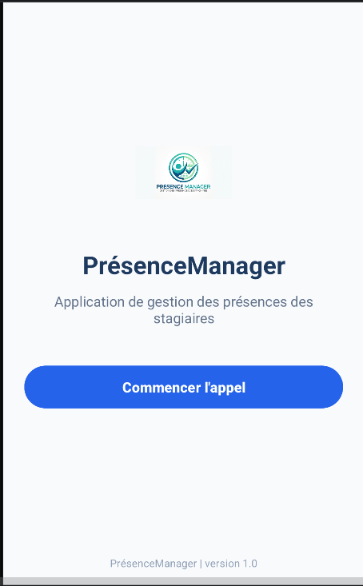
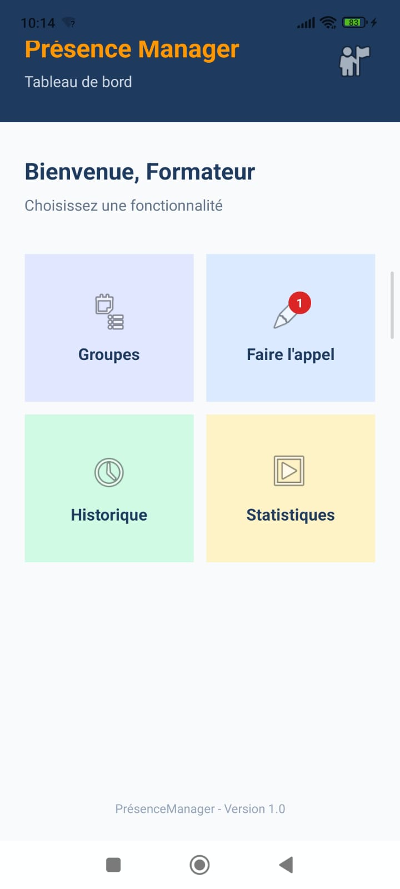

# 📱 Présence Manager

> **Module :** M203 - Développer des interfaces utilisateurs sous Android  
> **Filière :** Développement Digital — Option Applications Mobiles  
> **Technologies :** Kotlin + XML (Android Studio)  

---

## 📋 Table des matières
1. [À propos du projet](#-à-propos-du-projet)
2. [TP01 — Écran d'accueil](#-tp01--écran-daccueil)
3. [TP02 — Tableau de bord (Dashboard)](#-tp02--tableau-de-bord-dashboard)
4. [Structure du projet](#-structure-du-projet)
5. [Installation et exécution](#-installation-et-exécution)

---

## 🚀 À propos du projet
**Présence Manager** est une application Android conçue pour les établissements de formation afin de faciliter la gestion des présences et des absences des stagiaires.

Le projet regroupe les réalisations des travaux pratiques :
- **TP01** : Conception de l'écran d'accueil (`MainActivity`) avec `LinearLayout`.
- **TP02** : Conception du tableau de bord (`DashboardActivity`) combinant `ConstraintLayout`, `RelativeLayout`, `LinearLayout`, `GridLayout` et `FrameLayout`.

---

## 🏠 TP01 — Écran d'accueil

### Structure et Design
L'interface de l'écran d'accueil repose sur une structure `LinearLayout` :
* **Layout Principal :** `LinearLayout` vertical avec un padding de `24dp` et un fond `#F8FAFC`.
* **Contenu Central :** `LinearLayout` vertical centré (`layout_weight="1"`), regroupant le logo, le titre, la description et le bouton d'action.
* **Pied de page :** `TextView` fixé en bas avec le nom de l'application et la version.

### Composants et Identifiants (TP01)

| Composant | Élément XML | Identifiant (ID) |
| :--- | :--- | :--- |
| **Layout principal** | `LinearLayout` | `@+id/layoutAccueil` |
| **Logo** | `ImageView` | `@+id/imgLogo` |
| **Titre** | `TextView` | `@+id/txtTitre` |
| **Description** | `TextView` | `@+id/txtDescription` |
| **Bouton** | `Button` | `@+id/btnCommencer` / `@+id/btnCommernicer` |
| **Pied de page** | `TextView` | `@+id/txtFooter` |

### Capture d'écran (TP01)
<p align="center">
  
</p>

---

## 📊 TP02 — Tableau de bord (Dashboard)

### Description
Le tableau de bord (`DashboardActivity`) représente l'interface principale accessible après l'écran d'accueil. Il permet au formateur d'accéder aux fonctionnalités essentielles :
- **Groupes** : Gestion des classes et listes de stagiaires.
- **Faire l'appel** : Prise de présence avec un badge de notification rouge indiquant une session à effectuer.
- **Historique** : Consultation des appels et présences passées.
- **Statistiques** : Analyse des données de présence et taux d'assiduité.

### Layouts utilisés
- **`ConstraintLayout` (`layoutDashboard`)** : Conteneur principal organisant l'en-tête, les textes de bienvenue, la grille et le pied de page avec contraintes relatives.
- **`RelativeLayout` (`layoutHeader`)** : Bandeau supérieur foncé (`#1E3A5F`) positionnant les textes à gauche et l'icône de profil à droite (`layout_alignParentEnd="true"`).
- **`LinearLayout`** : Utilisé pour structurer verticalement les textes de l'en-tête et chacune des 4 cartes de fonctionnalités.
- **`GridLayout` (`gridFonctionnalites`)** : Grille 2×2 positionnant les cartes avec `columnWeight="1"` et `layout_gravity="fill"`.
- **`FrameLayout` (`frameAppel`)** : Superposition du badge de notification rouge arrondi (`txtBadge`) sur l'icône "Faire l'appel".

### Composants et Identifiants (TP02)

| Composant | Élément XML | Identifiant (ID) |
| :--- | :--- | :--- |
| **Conteneur racine** | `ConstraintLayout` | `@+id/layoutDashboard` |
| **En-tête** | `RelativeLayout` | `@+id/layoutHeader` |
| **Textes en-tête** | `LinearLayout` | `@+id/layoutHeaderText` |
| **Titre en-tête** | `TextView` | `@+id/txtAppName` |
| **Sous-titre** | `TextView` | `@+id/txtSubtitle` |
| **Icône profil** | `ImageView` | `@+id/imgProfil` |
| **Message bienvenue** | `TextView` | `@+id/txtBienvenue` |
| **Texte instruction** | `TextView` | `@+id/txtInstruction` |
| **Grille 2x2** | `GridLayout` | `@+id/gridFonctionnalites` |
| **Carte Groupes** | `LinearLayout` | `@+id/cardGroupes` |
| **Carte Faire l'appel** | `LinearLayout` | `@+id/cardAppel` |
| **Conteneur badge** | `FrameLayout` | `@+id/frameAppel` |
| **Badge rouge** | `TextView` | `@+id/txtBadge` |
| **Carte Historique** | `LinearLayout` | `@+id/cardHistorique` |
| **Carte Statistiques** | `LinearLayout` | `@+id/cardStatistiques` |
| **Pied de page** | `TextView` | `@+id/txtFooterDashboard` |

### Couleurs et dimensions
- **Fond principal :** `#F8FAFC`
- **En-tête :** `#1E3A5F` (Titre `#FF9800` en gras `25sp`, Sous-titre `#CBD5E1` en `15sp`, Icône `42dp × 42dp`)
- **Bienvenue :** `#1E3A5F` (Gras, `23sp`) | **Instruction :** `#647488` (`15sp`)
- **Cartes fonctionnalités (hauteur 145dp, marge 6dp, padding 12dp) :**
  - Groupes : fond `#E0E7FF`
  - Faire l'appel : fond `#DBEAFE`
  - Historique : fond `#D1FAE5`
  - Statistiques : fond `#FEF3C7`
- **Badge rouge :** `22dp × 22dp`, fond `#DC2626`, coins arrondis `11dp` (`badge_background.xml`), texte blanc centré `12sp` gras
- **Pied de page :** `#94A3B8`, centré, `12sp`, marge basse `24dp`

### Capture d'écran (TP02)

<p align="center">
  
</p>

---

## 📂 Structure du Projet

```
PresenceManager/
├── app/
│   ├── src/
│   │   ├── main/
│   │   │   ├── java/com/example/presencemanager/
│   │   │   │   ├── MainActivity.kt         # Écran d'accueil (TP01)
│   │   │   │   └── DashboardActivity.kt    # Tableau de bord (TP02)
│   │   │   ├── res/
│   │   │   │   ├── layout/
│   │   │   │   │   ├── activity_main.xml       # Layout accueil
│   │   │   │   │   └── activity_dashboard.xml  # Layout tableau de bord
│   │   │   │   ├── drawable/
│   │   │   │   │   ├── badge_background.xml    # Drawable pour le badge rouge
│   │   │   │   │   └── logo_presence.jpg
│   │   │   └── AndroidManifest.xml
├── screenshots/
│   └── dashboard_tp02.png                  # Capture d'écran du TP02
├── resultat.png                            # Capture d'écran du TP01
└── README.md
```

---

## ⚙️ Installation et Exécution

1. **Cloner le dépôt :**
   ```bash
   git clone https://github.com/Aymen-ELYAAKOUBI/PresenceManager.git
   ```
2. **Ouvrir le projet dans Android Studio.**
3. **Synchroniser avec Gradle** (`File > Sync Project with Gradle Files`).
4. **Lancer sur un émulateur ou appareil physique** (`Run 'app'`).
5. Sur l'écran d'accueil, cliquer sur le bouton **"Commencer l'appel"** pour naviguer vers le tableau de bord.
