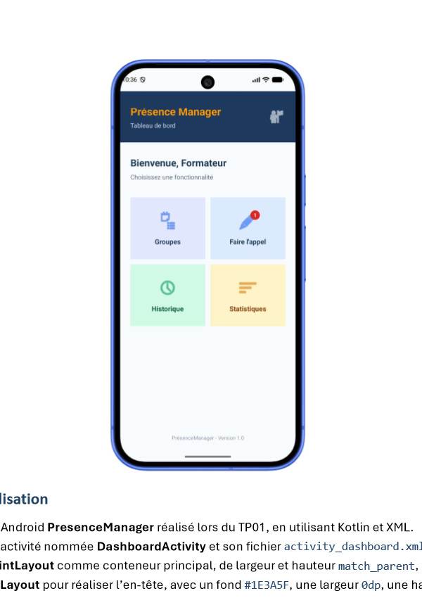
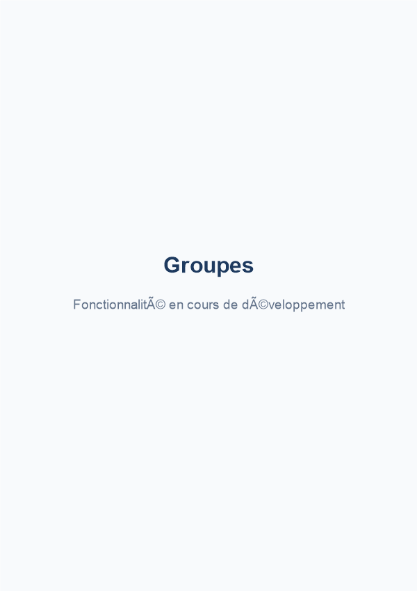
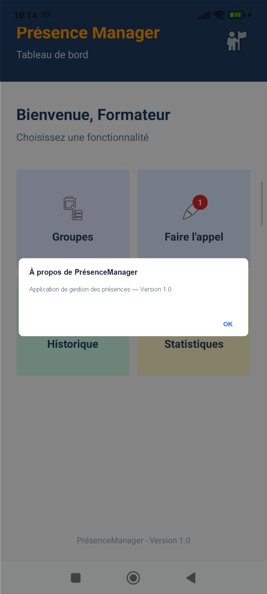
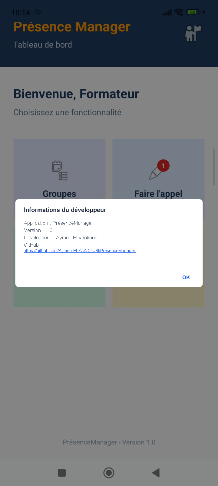

# 📱 Présence Manager

> **Module :** M203 - Développer des interfaces utilisateurs sous Android  
> **Filière :** Développement Digital — Option Applications Mobiles  
> **Technologies :** Kotlin + XML (Android Studio)  
> **Auteur / Développeur :** Aymen El yaakoubi  
> **Dépôt GitHub :** [https://github.com/Aymen-ELYAAKOUBI/PresenceManager](https://github.com/Aymen-ELYAAKOUBI/PresenceManager)

---

## 📋 Table des matières
1. [À propos du projet](#-à-propos-du-projet)
2. [Concepts clés : Événements et Event Listeners](#-concepts-clés--événements-et-event-listeners)
3. [TP01 — Écran d'accueil](#-tp01--écran-daccueil)
4. [TP02 — Tableau de bord (Dashboard)](#-tp02--tableau-de-bord-dashboard)
5. [TP03 — Gestion des événements](#-tp03--gestion-des-événements)
6. [Captures d'écran](#-captures-décran)
7. [Structure du projet](#-structure-du-projet)
8. [Installation et exécution](#-installation-et-exécution)

---

## 🚀 À propos du projet
**Présence Manager** est une application mobile Android conçue pour les établissements de formation afin de faciliter la gestion des présences et des absences des stagiaires.

Le projet regroupe les réalisations des travaux pratiques suivants :
- **TP01** : Conception de l'écran d'accueil (`MainActivity`) avec `LinearLayout`.
- **TP02** : Conception du tableau de bord (`DashboardActivity`) combinant `ConstraintLayout`, `RelativeLayout`, `LinearLayout`, `GridLayout` et `FrameLayout`.
- **TP03** : Programmation des interactions utilisateur et gestion des événements en Kotlin (clic simple, appui long, double-clic et boîtes de dialogue dynamiques avec liens cliquables).

---

## 💡 Concepts clés : Événements et Event Listeners

### 1. Qu'est-ce qu'un événement utilisateur ?
Un **événement utilisateur** correspond à toute interaction physique ou logique effectuée par l'utilisateur sur l'interface graphique de l'appareil (toucher l'écran, maintenir un doigt appuyé, double-taper, faire glisser, etc.). Le système Android génère alors un objet événementiel (tel que `MotionEvent`) et le transmet au composant cible (`View`).

### 2. Rôle d'un Event Listener
Un **Event Listener** (écouteur d'événement) est une interface contenant une méthode de rappel (callback). Son rôle est d'associer une réaction (comportement / logique métier) à un composant visuel dès qu'un événement survient. Ce traitement doit impérativement être écrit dans le code Kotlin.

### 3. Différence entre Clic Simple, Appui Long et Double-Clic
- **Clic simple (`onClick`)** : Déclenché lors d'un tapotement bref sur la vue (`OnClickListener`). Utilisé généralement pour la navigation immédiate ou la validation d'une action.
- **Appui maintenu (`onLongClick`)** : Déclenché lorsque l'utilisateur maintient la pression sur un composant pendant un laps de temps prolongé (environ 500 ms) via `OnLongClickListener`. Il retourne un booléen (`true` pour indiquer que l'événement est consommé, évitant ainsi le déclenchement intempestif du clic simple). Utilisé pour afficher de l'aide contextuelle (Toast) ou un menu secondaire sans naviguer.
- **Geste de double-clic (`onDoubleTap`)** : Détecte deux appuis consécutifs et très rapprochés dans le temps sur le même élément. Il n'existe pas d'`OnDoubleClickListener` natif dans le SDK Android ; on utilise donc un `GestureDetector` combiné à `SimpleOnGestureListener` et un `OnTouchListener`.

---

## 🏠 TP01 — Écran d'accueil

L'interface de l'écran d'accueil repose sur une structure `LinearLayout` :
* **Layout Principal :** `LinearLayout` vertical avec padding de `24dp` et fond `#F8FAFC`.
* **Contenu Central :** `LinearLayout` vertical centré (`layout_weight="1"`), regroupant le logo, le titre, la description et le bouton d'action.
* **Pied de page :** `TextView` fixé en bas avec le nom de l'application et la version.

| Composant | Élément XML | Identifiant (ID) |
| :--- | :--- | :--- |
| **Layout principal** | `LinearLayout` | `@+id/layoutAccueil` |
| **Logo** | `ImageView` | `@+id/imgLogo` |
| **Titre** | `TextView` | `@+id/txtTitre` |
| **Description** | `TextView` | `@+id/txtDescription` |
| **Bouton** | `Button` | `@+id/btnCommencer` |
| **Pied de page** | `TextView` | `@+id/txtFooter` |

---

## 📊 TP02 — Tableau de bord (Dashboard)

Le tableau de bord (`DashboardActivity`) structure l'interface des formateurs avec des Layouts complémentaires :
- **`ConstraintLayout` (`layoutDashboard`)** : Conteneur principal.
- **`RelativeLayout` (`layoutHeader`)** : En-tête supérieur bleu foncé (`#1E3A5F`) avec textes et icône de profil à droite.
- **`GridLayout` (`gridFonctionnalites`)** : Grille 2×2 positionnant les 4 cartes avec `columnWeight="1"` et `layout_gravity="fill"`.
- **`FrameLayout` (`frameAppel`)** : Superposition du badge de notification rouge (`txtBadge`) sur l'icône d'appel.

| Composant | Identifiant (ID) | Rôle |
| :--- | :--- | :--- |
| **Conteneur racine** | `@+id/layoutDashboard` | `ConstraintLayout` principal |
| **En-tête** | `@+id/layoutHeader` | Bandeau supérieur |
| **Titre / Sous-titre** | `@+id/txtAppName` / `@+id/txtSubtitle` | Titres d'en-tête |
| **Icône profil** | `@+id/imgProfil` | Icône en haut à droite |
| **Bienvenue / Instruction** | `@+id/txtBienvenue` / `@+id/txtInstruction` | Textes d'accueil |
| **Grille 2x2** | `@+id/gridFonctionnalites` | Grille des cartes |
| **Cartes** | `cardGroupes`, `cardAppel`, `cardHistorique`, `cardStatistiques` | 4 cartes de fonctionnalités |
| **Badge** | `@+id/txtBadge` | Notification "1" sur l'appel |
| **Pied de page** | `@+id/txtFooterDashboard` | Version 1.0 (placé directement sous la grille) |

---

## ⚡ TP03 — Gestion des événements

Le TP03 donne vie aux interfaces grâce aux écouteurs d'événements programmés en Kotlin :

### 1. Navigation par Clic Simple (`OnClickListener`)
- **Bouton « Commencer l'appel » (`btnCommencer`)** : Ouvre le tableau de bord `DashboardActivity`.
- **Les 4 cartes du tableau de bord** ouvrent chacune une activité dédiée :
  - `cardGroupes` ➔ `GroupesActivity` (`activity_groupes.xml`)
  - `cardAppel` ➔ `AppelActivity` (`activity_appel.xml`)
  - `cardHistorique` ➔ `HistoriqueActivity` (`activity_historique.xml`)
  - `cardStatistiques` ➔ `StatistiquesActivity` (`activity_statistiques.xml`)
  *Chaque écran de destination présente un titre centré en gras (`24sp`, `#1E3A5F`) et la mention « Fonctionnalité en cours de développement » (`16sp`, `#64748B`).*

### 2. Aide contextuelle par Appui Long (`OnLongClickListener`)
- **Appui long sur `cardGroupes`** : Affiche un Toast informatif *« Groupes : sélectionner ou consulter les groupes »*.
- **Appui long sur `cardAppel`** : Affiche un Toast informatif *« Faire l'appel : démarrer une séance »*.
- L'écouteur retourne `true` pour consommer l'événement et éviter l'ouverture accidentelle de la page de destination.

### 3. Double-clic sur l'icône de profil (`GestureDetector` + `onDoubleTap`)
- Sur `imgProfil`, un appui simple ne déclenche rien.
- Deux tapotements rapides déclenchent `onDoubleTap()` qui affiche un `AlertDialog` :
  - **Titre :** `À propos de PrésenceManager`
  - **Message :** `Application de gestion des présences — Version 1.0`
  - **Bouton :** `OK`

### 4. Boîte « Informations du développeur » via `Version 1.0`
- Accessible par un clic simple sur `txtFooter` (accueil) ou `txtFooterDashboard` (tableau de bord).
- Affiche une boîte de dialogue `AlertDialog` complète :
  - **Titre :** `Informations du développeur`
  - **Message :**
    ```text
    Application : PrésenceManager
    Version : 1.0
    Développeur : Aymen El yaakoubi
    GitHub : https://github.com/Aymen-ELYAAKOUBI/PresenceManager
    ```
  - **Lien interactif :** Le lien GitHub est rendu cliquable grâce à `Linkify.addLinks(texte, Linkify.WEB_URLS)` et `LinkMovementMethod.getInstance()`.

---

## 📸 Captures d'écran

| 1. Tableau de bord (TP02 / TP03) | 2. Page ouverte par clic simple (`GroupesActivity`) |
| :---: | :---: |
|  |  |

| 3. Double-clic sur profil (`À propos`) | 4. Clic Version 1.0 (`Informations développeur`) |
| :---: | :---: |
|  |  |

---

## 📂 Structure du Projet

```
PresenceManager/
├── app/
│   ├── src/
│   │   ├── main/
│   │   │   ├── java/com/example/presencemanager/
│   │   │   │   ├── MainActivity.kt         # Accueil (TP01) + dialogue développeur (TP03)
│   │   │   │   ├── DashboardActivity.kt    # Tableau de bord (TP02) + gestion des événements (TP03)
│   │   │   │   ├── GroupesActivity.kt      # Destination Groupes (TP03)
│   │   │   │   ├── AppelActivity.kt        # Destination Faire l'appel (TP03)
│   │   │   │   ├── HistoriqueActivity.kt   # Destination Historique (TP03)
│   │   │   │   └── StatistiquesActivity.kt # Destination Statistiques (TP03)
│   │   │   ├── res/
│   │   │   │   ├── layout/
│   │   │   │   │   ├── activity_main.xml          # Accueil
│   │   │   │   │   ├── activity_dashboard.xml     # Tableau de bord (Footer sous grille)
│   │   │   │   │   ├── activity_groupes.xml       # Page Groupes
│   │   │   │   │   ├── activity_appel.xml         # Page Faire l'appel
│   │   │   │   │   ├── activity_historique.xml    # Page Historique
│   │   │   │   │   └── activity_statistiques.xml  # Page Statistiques
│   │   │   │   ├── drawable/
│   │   │   │   │   ├── badge_background.xml       # Badge rouge arrondi
│   │   │   │   │   └── logo_presence.jpg
│   │   │   └── AndroidManifest.xml
├── screenshots/
│   ├── dashboard_tp02.png                         # Capture TP02
│   ├── dashboard_tp03.png                         # Capture Dashboard TP03
│   ├── page_groupes.png                           # Capture clic simple
│   ├── dialogue_apropos.png                       # Capture double-clic profil
│   └── dialogue_developpeur.png                   # Capture infos développeur
├── resultat.png                                   # Capture accueil TP01
└── README.md
```

---

## ⚙️ Installation et Exécution

1. **Cloner le dépôt :**
   ```bash
   git clone https://github.com/Aymen-ELYAAKOUBI/PresenceManager.git
   ```
2. **Ouvrir le projet dans Android Studio.**
3. **Synchroniser avec Gradle** (`File > Sync Project with Gradle Files`).
4. **Lancer sur un émulateur ou appareil physique** (`Run 'app'`).
5. Tester les interactions :
   - Clic sur **« Commencer l'appel »** pour basculer vers le tableau de bord.
   - Clic sur chacune des 4 cartes pour visiter les fonctionnalités.
   - Appui long sur **Groupes** ou **Faire l'appel** pour afficher le message Toast.
   - Double-clic sur l'icône de profil en haut à droite pour afficher la boîte **« À propos »**.
   - Clic sur le texte **« Version 1.0 »** pour afficher la boîte **« Informations du développeur »** avec le lien GitHub cliquable.
